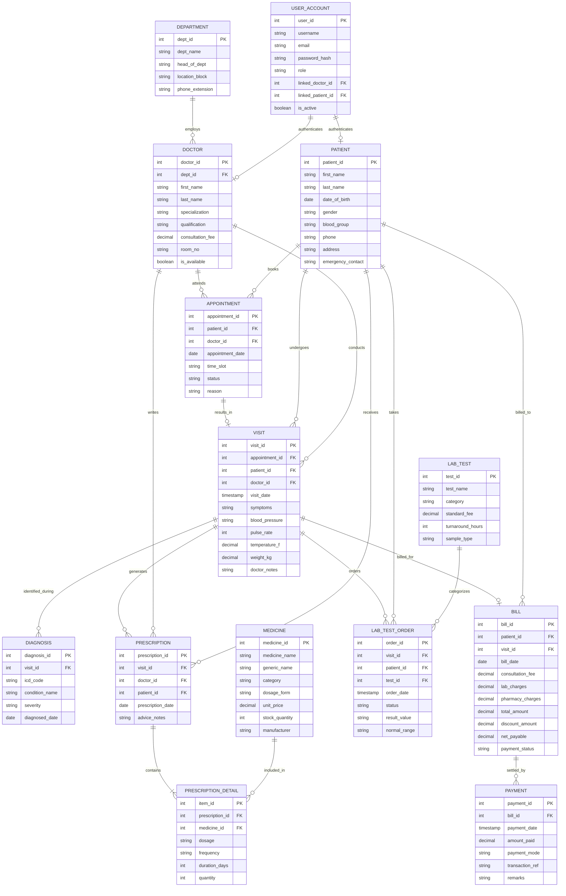

# Entity-Relationship (ER) Diagram & Conceptual Model
## Group 3: Kolkata City Hospital & Medical Research Centre (KCHMRC)

### 1. Conceptual Model Overview
The Kolkata City Hospital Management System manages healthcare operations across clinical, administrative, and financial domains. The ER model models entities, cardinalities, primary keys, and foreign key relationships.

### 2. Entity Cardinalities & Multiplicities
1. **DEPARTMENT to DOCTOR (1 : N)**: One department employs one or more doctors. Each doctor belongs to exactly one department.
2. **DOCTOR to APPOINTMENT (1 : N)**: A doctor can have multiple scheduled appointments over time.
3. **PATIENT to APPOINTMENT (1 : N)**: A patient can schedule multiple appointments.
4. **APPOINTMENT to VISIT (1 : 1 optional)**: An appointment may culminate in at most one recorded medical visit.
5. **VISIT to DIAGNOSIS (1 : N)**: A consultation visit can result in multiple clinical diagnoses (ICD-10 mapped).
6. **VISIT to PRESCRIPTION (1 : N)**: A visit may produce medical prescriptions.
7. **PRESCRIPTION to MEDICINE (M : N via PRESCRIPTION_DETAIL)**: A prescription details multiple medicines with dosage, frequency, and duration.
8. **VISIT to LAB_TEST_ORDER (1 : N)**: A doctor can order multiple diagnostic laboratory investigations per visit.
9. **VISIT to BILL (1 : 1 optional)**: Each outpatient visit produces a single itemized billing ledger.
10. **BILL to PAYMENT (1 : N)**: A single hospital bill can be settled in multiple installments (part payments or full settlement).
